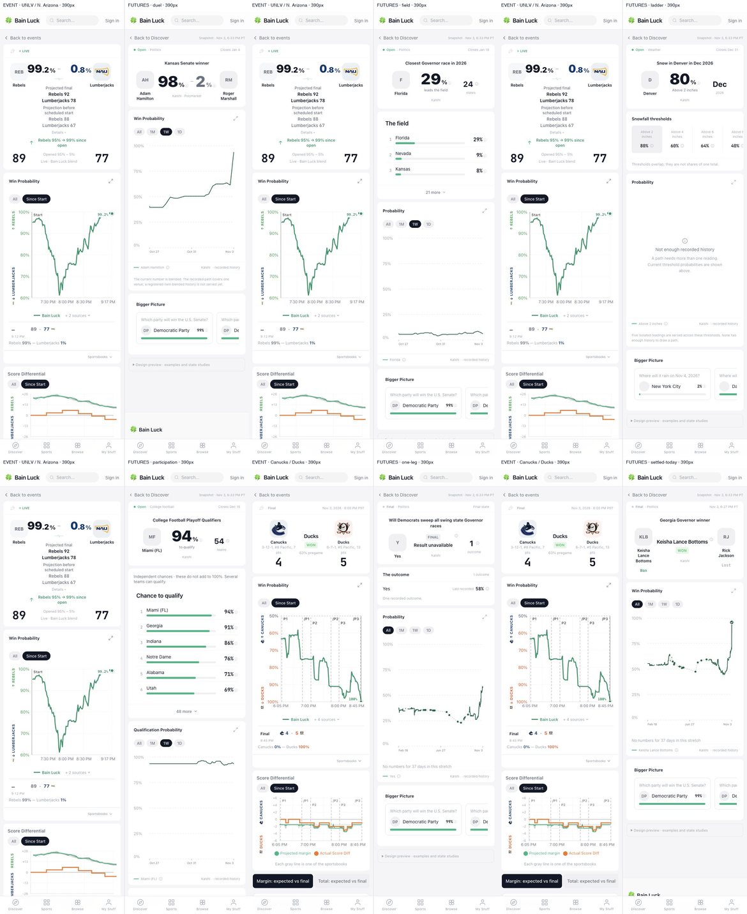

# Futures prototype · Iteration 2 evidence

**Preview:** [Vercel deployment](https://bainluck-bvmat1i4o-alexander-bain.vercel.app/kernels-preview/futures/109085). The deployment-scoped review link is in the Iteration 2 comment on [NOW #11852](https://github.com/alexander-bain/bainluck/issues/11852); its share capability is intentionally not committed. [One-page design note](../../futures-page-2026-11.md).

Branch `design/futures-page-proto`; rendered code `2629efea23`. This is a preview under `/kernels-preview/futures/[id]`, with production payload captures from Nov 3, 6:33 PM PT. The production route and APIs were not changed. No PR was opened.

Each full-size composite preserves the browser captures pixel for pixel: **event left, futures right**, with a 36px label above and a 2px divider. Mobile halves are 390 × 1400; desktop halves are 1280 × 1200. The overview alone is reduced. Privacy notices were declined through their own UI. The Vercel toolbar is disabled only for this deployment using `VERCEL_PREVIEW_FEEDBACK_ENABLED=0`.

Open examples use the real live [UNLV–Northern Arizona event](https://www.bainluck.com/events/15341108), captured with an 89–77 score and 99.2/0.8 paired hero. Settled examples use the real recent [Canucks–Ducks final](https://www.bainluck.com/events/15341089), 4–5. Those reference pages are unmodified. Their existing tenths/auto-scaled axes remain visible; this brief requires whole numbers and fixed 0–100 on the futures side.

| Market / state | 390px per half | 1280px per half |
|---|---|---|
| 109085 · duel | [Compare](duel-390.png) | [Compare](duel-1280.png) |
| 108629 · field | [Compare](field-390.png) | [Compare](field-1280.png) |
| 65536371 · quantity ladder | [Compare](ladder-390.png) | [Compare](ladder-1280.png) |
| 227 · participation band | [Compare](participation-390.png) | [Compare](participation-1280.png) |
| 109918 · one leg, as served | [Compare](one-leg-390.png) | [Compare](one-leg-1280.png) |
| 108645 · settled today | [Compare](settled-today-390.png) | [Compare](settled-today-1280.png) |
| 109918 · open layout study | [Compare](one-leg-open-390.png) | [Compare](one-leg-open-1280.png) |
| 109918 · settled layout study | [Compare](one-leg-settled-390.png) | [Compare](one-leg-settled-1280.png) |

**Validation.** Build passes; typecheck matches the existing 65-error baseline with no new errors; 12 focused Jest checks pass; backend startup 4/4. A new guard reproduces the stale age stamp's server-timezone mismatch before the fix. The preview now mounts the actual `PriceAgeMark` in the browser and uses the same reader clock as the chart; the UTC-server/Pacific-browser check and final hosted capture sweep are clean. All 16 futures viewports have document width equal to viewport width and zero final-preview console errors.

Interactive checks: field expansion exposes all 24 legs; a 6-inch threshold updates the hero to its served 64%; fullscreen opens, Escape closes and restores focus; range chips change selection; a related link reaches the real Senate market. The existing routes are navigation destinations, not modifications to production.

**Honest limits.** Kansas uses the existing registered-twin current blend and discloses single-venue history coverage. Denver has insufficient history and retains the served non-monotonic 60/64% thresholds. CFP remains an independent stored field. One-leg production is `ungradeable_result`; its open/settled screenshots are labelled studies. Georgia's real grade is Nov 3, 6:27 PM PT. See the note for missing payload fields and the actual web → SwiftUI mapping.

[Render checks](render-checks.json) · [Interaction checks](interaction-checks.json) · [Capture manifest](manifest.json) · [Raw screenshots](raw/) · [Mechanical composition script](compose.py)

Taste calls **E/F** remain recommendations in the note; old A–D are retired. No source sheet, assignment, approval label, production deployment, or master PR.
