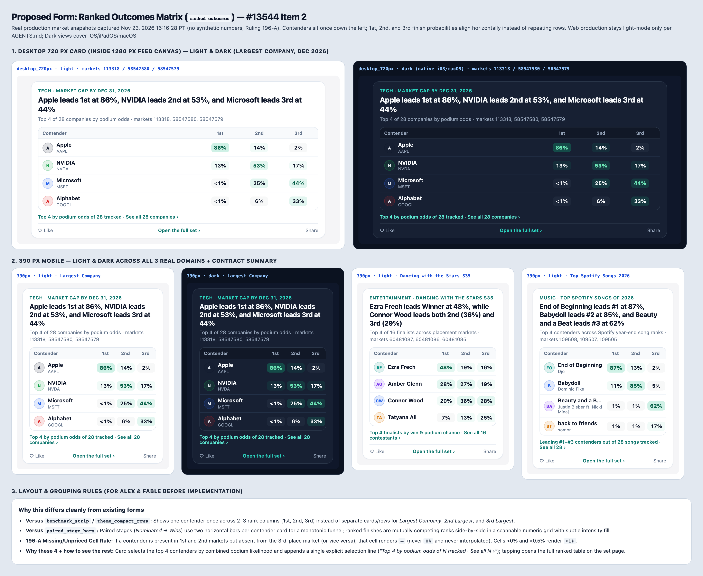

# Proposed Card Form: Ranked Outcomes Matrix (`ranked_outcomes`, #13544 Item 2)

*Drawn from live production market snapshots captured Nov 23, 2026 16:16:28 PT (Ruling 196-A: zero synthetic probabilities; web stays light-mode only per `AGENTS.md`, dark panels show native Apple parity).*

---

## 1. What It Fixes

In the first 40-set blind grading pass (`#13514` / `#13544`), three sets put **sibling rank markets for the same competition** on consecutive horizontal bar rows (`Largest Company end of December 2026?`, `2nd Largest Company end of December 2026?`, `3rd Largest Company end of December 2026?`, and similarly for `Dancing with the Stars S35` and `Top Spotify Songs/Artists 2026`). Readers see the same set of contenders scattered across separate rows instead of seeing where each contender finishes.

`ranked_outcomes` collapses those sibling rank markets into **one scannable contender-by-finish grid**:
- **Rows:** the contenders (`Apple`, `NVIDIA`, `Microsoft`, `Alphabet`, ...), ordered by combined podium probability across the sibling markets.
- **Columns:** finish positions (`1st`, `2nd`, `3rd`), aligned vertically with subtle proportional emerald intensity fills inside rounded pills (`tabular-nums`).
- **Headline:** names the #1 leader and notable 2nd/3rd leaders directly in plain prose (`"Apple leads 1st at 86%, NVIDIA leads 2nd at 53%, and Microsoft leads 3rd at 44%"`).

---

## 2. How It Differs From Existing Forms

| Form | Relationship Shown | Layout |
|---|---|---|
| `benchmark_strip` / `theme_compact_rows` | One market per row (different claims) | Stacked bars or boxed rows |
| `paired_stage_bars` | Two sequential qualification gates for one contender (`Nominated` → `Wins`) | Paired dual-bar rows (`100%` funnel down) |
| **`ranked_outcomes`** | **Sibling ordinal finish ranks (`1st` / `2nd` / `3rd`) over one contender set** | **Contender rows × rank columns matrix** |

---

## 3. Grouping & Rendering Rules (Before Implementation)

1. **Eligibility & frame dependency (`#1809` / `#1810`):** Requires 2–3 open sibling markets sharing the same competition entity/subject and ordinal placement slot (`rank ∈ {1, 2, 3}`), plus overlap of `>= 3` shared outcome contenders. Manual grouping first; automatic discovery waits for `#1809` frame + `#1810` same-thing key so ordinal siblings are paired without false positives.
2. **Ruling 196-A missing-cell rule:** When a contender appears in some sibling rank markets but is absent from another (for instance priced in 1st and 2nd but unpriced in 3rd), render **`—`** in the absent cell — never `0%` and never interpolated. Non-zero probabilities under `0.5%` render as `<1%`.
3. **Why these N + see the rest (`#13544` Item 4):** Show the top 4 contenders on the Discover card with a single selection note (`"Top 4 by podium odds of N tracked · See all N ›"`). Tapping opens the `/collections/<slug>` page showing the full ranked matrix and per-rank source attribution.
4. **Optional dated context slot (`#13544` Item 2):** When a trusted dated baseline reading exists in `market_metadata` (e.g., spot equity market cap with ISO `as_of` + source), render it in one muted line directly under the contender name; omit when absent (`196-A`).
