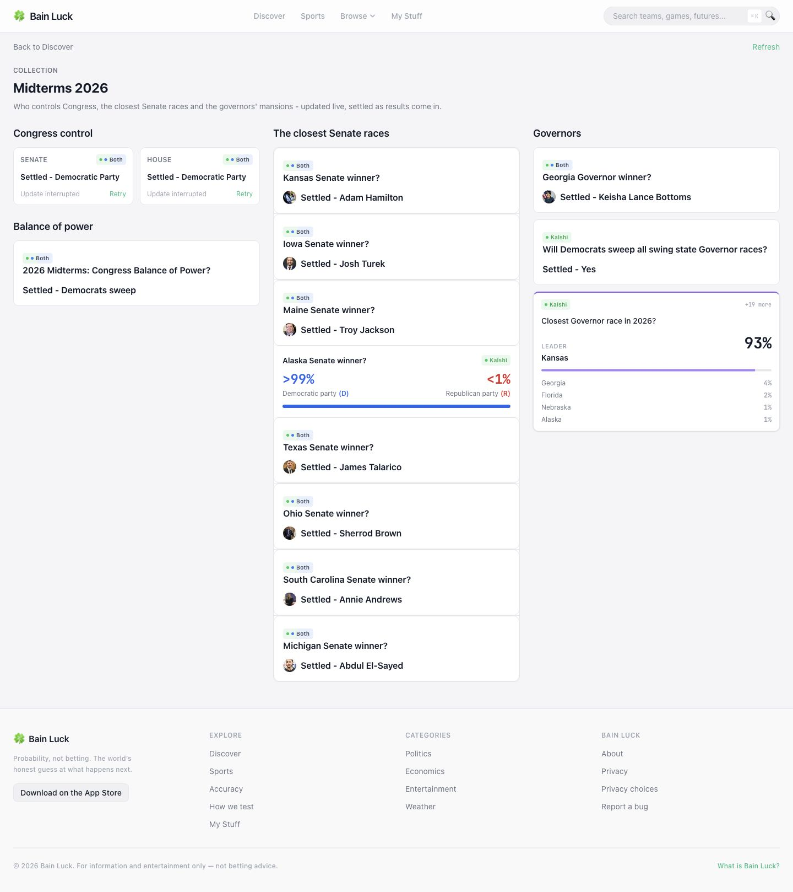

# Midterms candidate portraits and desktop columns

Pillar: FORMATTING. Ship: Midterms readers see the correct candidate portraits and compact desktop sections, while phone sections keep their reading order.

The existing Midterms twin register carries the verified Wikipedia article title for 16 named candidates in eight races. It is applied to matched outcome names before the official-settlement return, so the winner and an open leader use the same identity. It does not change a probability or result. A candidate outside the reviewed race cannot borrow its portrait. The web preserves the visible name and image alt text and uses the article title only for image lookup; no-photo behavior stays intact.

Midterms alone uses one column at 390 px, two columns at 1024 px and three at 1440 px. Congress control and balance of power stay together, then Senate, then Governors. The same DOM order supports keyboard and phone reading.

## Verification

- 113 backend/startup checks, including 32 open/settled candidate identity cases and an unrelated-name control.
- 61 web checks across collection presentation, next-refresh settlement and Atlas cards; all 12 clock points.
- Frontend build and typecheck pass, with the existing 65-error baseline unchanged. The final layout regroup exposed three nullable-state errors; they were corrected rather than added to the baseline.
- Browser proof used the local app with the public collection response saved at 2026-11-14 08:14:33 UTC. Only image-title fields were added to that fixture; prices and results were retained. All eight displayed candidate portraits loaded in default and Atlas presentations. No horizontal overflow at 390, 1024 or 1440 px. Refresh retained the page, and Back from Atlas mode returned to the default presentation.
- These are local captures, not production proof. The fixture does not supply chart history, so the captures' “Update interrupted” text is a fixture limitation. Member-page Back and served deployment checks remain required after delivery. No installed native proof is claimed.

## Captures

[1440 px](desktop-1440.jpg) · [1024 px](desktop-1024.jpg) · [390 px](phone-390.jpg) · [Atlas 390 px](atlas-phone-390.jpg) · [Back 390 px](phone-back-390.jpg)

## Public identity sources

MediaWiki article and thumbnail reads were saved with the local receipts. Disambiguated identities matter: Mike Rogers is the Michigan politician, Rick Jackson the businessman, and Adam Hamilton's American-politician redirect resolves to Adam Hamilton (pastor).

- [Abdul El-Sayed](https://en.wikipedia.org/wiki/Abdul_El-Sayed)
- [Adam Hamilton (pastor)](https://en.wikipedia.org/wiki/Adam_Hamilton_(pastor))
- [Annie Andrews](https://en.wikipedia.org/wiki/Annie_Andrews)
- [Ashley Hinson](https://en.wikipedia.org/wiki/Ashley_Hinson)
- [Darline Graham](https://en.wikipedia.org/wiki/Darline_Graham)
- [James Talarico](https://en.wikipedia.org/wiki/James_Talarico)
- [Jon Husted](https://en.wikipedia.org/wiki/Jon_Husted)
- [Josh Turek](https://en.wikipedia.org/wiki/Josh_Turek)
- [Keisha Lance Bottoms](https://en.wikipedia.org/wiki/Keisha_Lance_Bottoms)
- [Ken Paxton](https://en.wikipedia.org/wiki/Ken_Paxton)
- [Mike Rogers (Michigan politician)](https://en.wikipedia.org/wiki/Mike_Rogers_(Michigan_politician))
- [Rick Jackson (businessman)](https://en.wikipedia.org/wiki/Rick_Jackson_(businessman))
- [Roger Marshall](https://en.wikipedia.org/wiki/Roger_Marshall)
- [Sherrod Brown](https://en.wikipedia.org/wiki/Sherrod_Brown)
- [Susan Collins](https://en.wikipedia.org/wiki/Susan_Collins)
- [Troy Jackson](https://en.wikipedia.org/wiki/Troy_Jackson)
