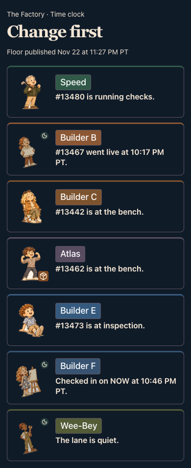
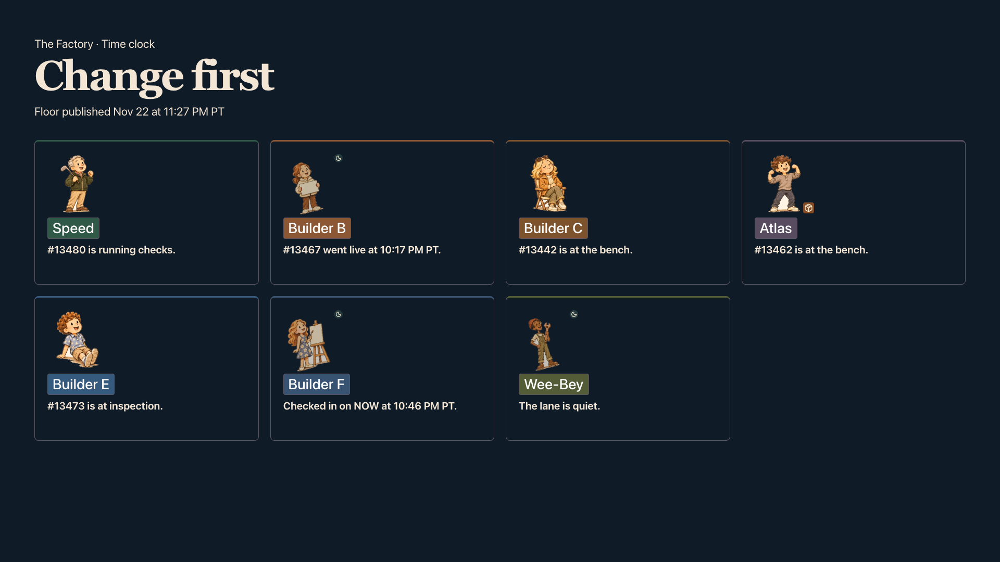
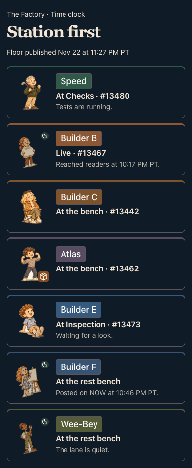
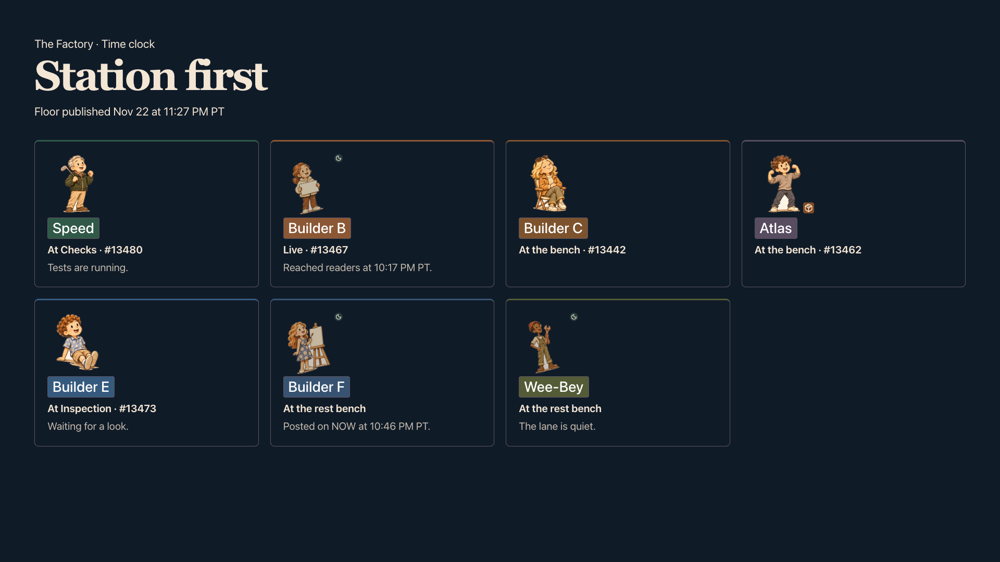
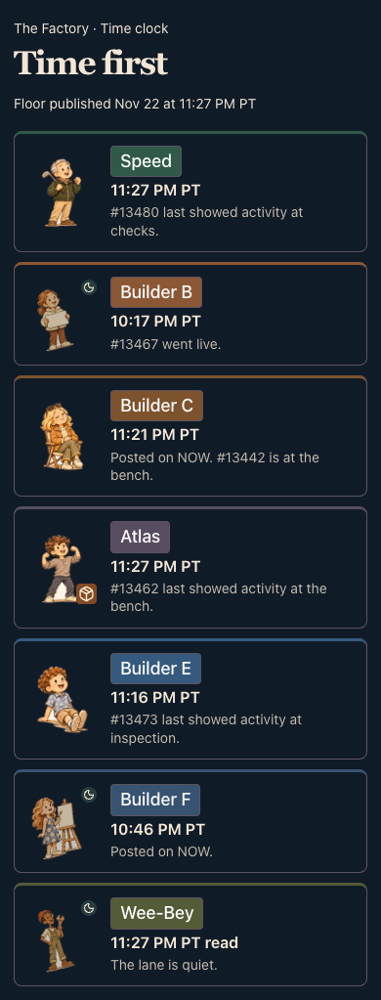
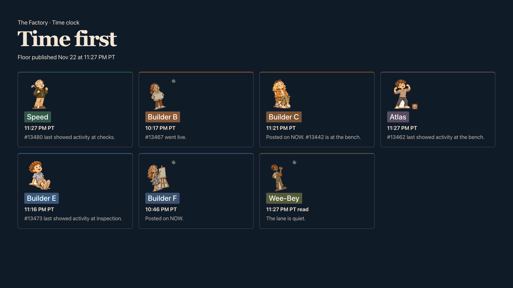

# Three ways to read a lane card

All seven lanes use the Factory floor published on Sunday, Nov 22 at 11:27 PM PT, with signed check-in times from NOW. These are page renders for review.

| Option | 390 px | 1920 × 1080 |
| --- | --- | --- |
| **Change first** |  |  |
| **Station first** |  |  |
| **Time first** |  |  |

Select an image to open the full-size render.
